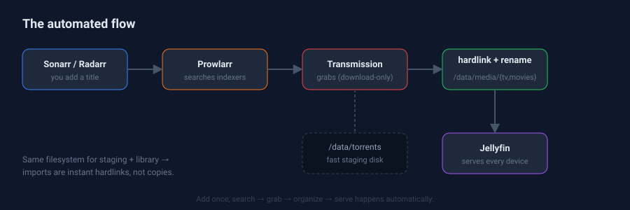
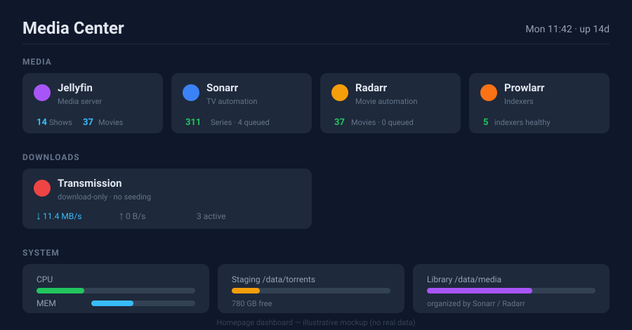

# Self-Hosted Media Center (Transmission → Sonarr/Radarr → Jellyfin)

A complete, reproducible guide for a **fully-automated, download-only** media center on a
single Linux box, reachable privately over [Tailscale](https://tailscale.com), with **one
dashboard** for everything.

```
                         ┌──────────────────────────────────────────┐
                         │                Homepage                   │
                         │        single dashboard  (:7575)          │
                         └──────────────────────────────────────────┘
                                          ▲ widgets
          add a show/movie ──►  ┌─────────┴──────────┐
                                │ Sonarr (TV)  :8989 │
                                │ Radarr (film):7878 │
                                └─────────┬──────────┘
         search indexers  ◄──── Prowlarr :9696       │ grab
                                          │           ▼
                                ┌─────────┴──────────────────────┐
                                │ Transmission :9091 (download-  │
                                │ only, no seeding) → /srv/torrents
                                └─────────┬──────────────────────┘
                                          │ hardlink + rename
                                          ▼
                                /srv/media/{tv,movies}
                                          │
                                          ▼
                                ┌──────────────────┐
                                │ Jellyfin  :8096  │  serves to any device
                                └──────────────────┘
```



**What you get**

- Add a title in Sonarr/Radarr → it searches your indexers (via Prowlarr) → grabs the best
  release in Transmission → hardlinks + renames it into a clean library → Jellyfin serves it.
  No manual steps after the initial add.
- **Download-only**: every torrent stops the instant it completes — no seeding or sharing.
- **Private by default**: all web UIs are exposed *only* on the Tailscale interface, never to
  the public internet or even the LAN.
- **One pane of glass**: a Homepage dashboard with live widgets for every service plus host
  CPU/mem/disk.

> ⚠️ **Downloading copyrighted material may be illegal where you live.** This guide is for
> managing media you are legally entitled to (your own rips, public-domain works, Linux ISOs,
> etc.). You are responsible for how you use it.

---

## Contents

1. [Requirements](docs/00-requirements.md)
2. [Tailscale (private networking)](docs/01-tailscale.md)
3. [Transmission (download-only)](docs/02-transmission.md)
4. [Jellyfin (media server)](docs/03-jellyfin.md)
5. [Sonarr & Radarr (automation)](docs/04-sonarr-radarr.md)
6. [Prowlarr (indexers)](docs/05-prowlarr.md)
7. [Auto-import timer](docs/06-autoimport.md)
8. [Homepage (dashboard)](docs/07-homepage.md)
9. [Gotchas & troubleshooting](docs/08-gotchas.md)
10. [Docker Compose variant (SBC / RK3588)](docs/09-docker-compose.md)



*The Homepage dashboard — one pane for every service (illustrative mockup, no real data).*

## Two ways to deploy

- **Bare metal** — follow chapters 1–8 (systemd services, native installs). Best if you want
  each service managed by the OS directly.
- **Docker Compose** — [chapter 10](docs/09-docker-compose.md) + [`docker-compose/`](docker-compose/).
  One `docker compose up -d`; multi-arch images run as-is on **arm64 SBCs** (Raspberry Pi,
  Rock 5B / RK3588, Orange Pi 5, …). Includes optional Rockchip hardware-transcode notes.

Example config files live in [`config-examples/`](config-examples/) and helper scripts in
[`scripts/`](scripts/). **Every secret is a placeholder** — see below.

---

## Everyday workflow

Once it's all set up, you only ever touch **two apps**:

1. **Get something** — add it in **Radarr** (movies) or **Sonarr** (TV). Tick *search on add*
   and it downloads + organizes itself.
2. **Watch** — open **Jellyfin** on any device; new titles appear automatically.

> **Never grab from Prowlarr's Search tab** — it has no downloader attached and will say
> *"torrent downloader not configured."* Prowlarr runs in the background feeding indexers to
> Radarr/Sonarr; you don't search in it. See [gotchas](docs/08-gotchas.md).

> **Want a single Netflix-style search page?** That's **Seerr** (formerly Jellyseerr) — one
> search box that routes requests to Radarr/Sonarr for you. **Seerr 3.5.2 works with Jellyfin
> 12.4**; only the old Jellyseerr 2.x line didn't, so upgrade rather than downgrading Jellyfin.
> Pull `ghcr.io/seerr-team/seerr:v3.5.2` (the `v` prefix matters) and read the
> [`NO_ADMIN_USER` trap](docs/08-gotchas.md#the-no_admin_user-trap-it-is-not-about-admin-permissions)
> first. Jellyfin itself can never search or download — that always lives in Sonarr/Radarr.

## Conventions / placeholders

Replace these everywhere they appear. **Never commit real values to a public repo.**

| Placeholder          | Meaning                                                  |
|----------------------|----------------------------------------------------------|
| `<TAILSCALE_IP>`     | Your server's Tailscale IP (e.g. `100.x.y.z`)            |
| `<LAN_SUBNET>`       | Your LAN subnet, e.g. `192.168.1.0/24`                   |
| `<DL_USER>`          | Transmission RPC username                                |
| `<DL_PASS>`          | Transmission RPC password                                |
| `<SONARR_API_KEY>`   | From Sonarr → Settings → General                         |
| `<RADARR_API_KEY>`   | From Radarr → Settings → General                         |
| `<PROWLARR_API_KEY>` | From Prowlarr → Settings → General                       |
| `<JELLYFIN_API_KEY>` | From Jellyfin → Dashboard → API Keys                     |
| `<SEERR_API_KEY>`    | From Seerr → Settings → General                         |

Paths used throughout:

- `/srv/torrents` — download staging (put this on your **fastest** disk; e.g. NVMe)
- `/srv/media/tv`, `/srv/media/movies` — organized libraries Jellyfin reads

All services run as the **`debian-transmission`** user so that downloads and the organized
library share one owner — this is what makes instant **hardlinks** (not slow copies) work and
avoids `fs.protected_hardlinks` denials.

## Why this design

- **One disk for staging + library** → Sonarr/Radarr hardlink instead of copy: imports are
  instant and use no extra space until you move files off to cold storage.
- **One service user** → no permission juggling between the downloader and the organizers.
- **Tailscale-only firewall** → your media center is on your private tailnet; nothing is
  reachable from the public internet, so you don't run a reverse proxy or open router ports.

## License

[MIT](LICENSE) — the documentation and scripts. Trademarks and the software it configures
(Jellyfin, Sonarr, etc.) belong to their respective projects.
